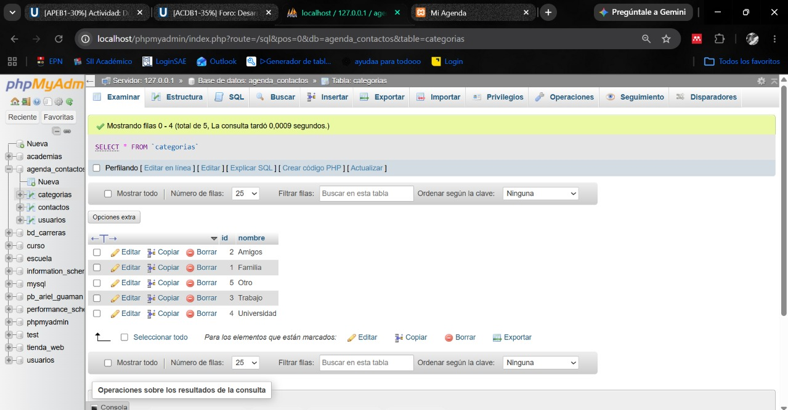
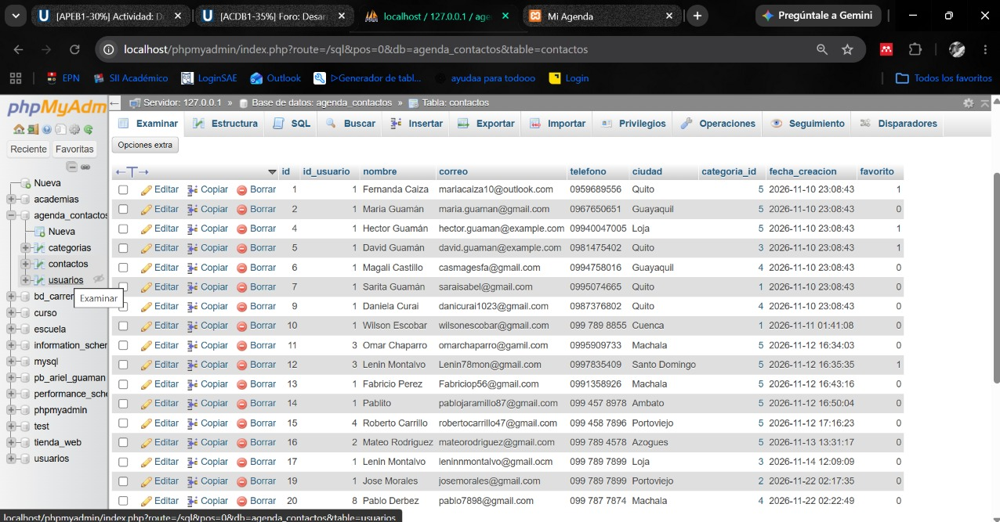
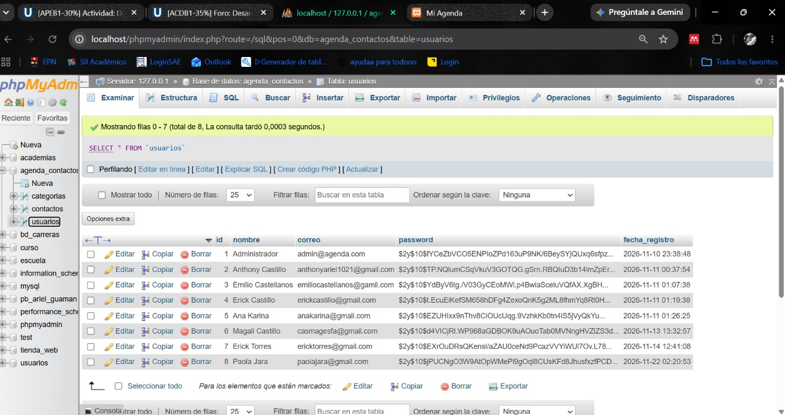

# Agenda Personal de Contactos (PHP + MySQL)

Aplicación web desarrollada en PHP y MySQL para la gestión de contactos personales, con inicio de sesión, aislamiento de información por usuario, búsqueda, ordenamiento, categorías, contactos favoritos y despliegue en un hosting gratuito.

## 1. URL Pública
- **Enlace de la aplicación en línea:** (http://agenda-contactos-arielutpl.infinityfree.io/login.php)
## 2. Capturas de Pantalla
### Inicio de Sesión y Registro

### Agenda Principal (Búsqueda, Categorías, Ordenamiento y Favoritos)

### Editar y Agregar Contacto con Categoría y Favorito

### Base de Datos - Tabla de Categorías (phpMyAdmin)

### Base de Datos - Tabla de Contactos (phpMyAdmin)

### Base de Datos - Tabla de Usuarios (phpMyAdmin)

## 3. Tecnologías Utilizadas
- **Lenguaje de programación (Backend — PHP):** Se utiliza PHP en el lado del servidor para procesar formularios, administrar sesiones de usuario (`$_SESSION` y `session_regenerate_id`), aislar los contactos de cada cuenta y controlar la lógica de negocio. La comunicación con la base de datos se realiza mediante la extensión `mysqli` con consultas preparadas (`prepare` y `bind_param`) para prevenir inyección SQL, junto con `password_hash()` y `password_verify()` para almacenar y comprobar contraseñas de forma segura.
- **Base de datos (MySQL / MariaDB — `agenda_contactos`):** Almacena de manera estructurada los usuarios, los contactos y las categorías (*Familia, Amigos, Trabajo, Universidad, Otro*), relacionando los contactos con su propietario (`id_usuario`) y con su categoría (`categoria_id`) mediante claves y consultas `JOIN` para listar, filtrar, buscar y ordenar la información.
- **Frontend (HTML5, CSS3 y Bootstrap 5):** Construye las vistas y formularios de inicio de sesión, registro, agenda principal, creación y edición de contactos, y cambio de contraseña. Combina componentes de Bootstrap 5 (tablas, formularios, alertas y botones) con estilos personalizados en `estilos.css` para lograr una interfaz oscura y ordenada.
- **Entorno local y despliegue (XAMPP y Hosting Gratuito):** Durante el desarrollo y las pruebas iniciales se emplea XAMPP (`Apache` y `MySQL` en `localhost`) junto con `phpMyAdmin` para gestionar y exportar la base de datos (`agenda_contactos.sql`). Para la publicación en línea, el proyecto y la base de datos importada se alojan en un servicio de hosting gratuito accessible mediante URL pública.

## 4. Instrucciones para Instalar el Proyecto Localmente
1. Clonar o descargar el repositorio y colocar la carpeta del proyecto dentro del directorio raíz de tu servidor local (por ejemplo, en `htdocs` si utilizas XAMPP).
2. Abrir el panel de control de XAMPP e iniciar los servicios **Apache** y **MySQL**.
3. Acceder a `phpMyAdmin` (`http://localhost/phpmyadmin`), crear la base de datos `agenda_contactos` e importar el archivo `agenda_contactos.sql` incluido en el repositorio.
4. Verificar que el archivo `conexion.php` tenga configurados los parámetros locales (`localhost`, usuario `root`, contraseña vacía y base de datos `agenda_contactos`).
5. Abrir el navegador y visitar `http://localhost/tu_carpeta/login.php` para iniciar sesión o crear una cuenta.

## 5. Mejoras y Correcciones realizadas respecto a la primera versión

### Mejoras Funcionales Implementadas
- **Categorías de contactos:** se creó la tabla `categorias` con las opciones *Familia*, *Amigos*, *Trabajo*, *Universidad* y *Otro*, vinculada a `contactos` mediante `categoria_id`, permitiendo asignar categorías al crear o editar contactos y filtrar por categoría en `agenda.php`.
- **Búsqueda de contactos:** filtro por nombre, correo electrónico o ciudad mediante consultas preparadas con `LIKE`.
- **Ordenamiento de contactos:** ordenamiento por nombre (A-Z / Z-A), ciudad (A-Z) y fecha de creación.
- **Contactos favoritos:** posibilidad de marcar/desmarcar contactos como favoritos y filtrar para mostrar únicamente los favoritos.
- **Despliegue en hosting gratuito:** publicación de la aplicación y su base de datos en un servicio de hosting gratuito accesible mediante enlace público.

### Correcciones de Seguridad y Validación mediante las oberservaciones de mi primer entregable.
- **Registro de usuarios (`guardar_usuario.php`):** se incorporó validación del formato de correo electrónico mediante `FILTER_VALIDATE_EMAIL` y verificación previa para evitar registros con correos duplicados.
- **Gestión de sesiones (`login.php`):** se añadió `session_regenerate_id(true)` inmediatamente después de autenticar al usuario para reforzar la seguridad de la sesión.
- **Validación en contactos (`guardar_contacto.php` y `actualizar_contacto.php`):** se reemplazó `FILTER_SANITIZE_EMAIL` por `FILTER_VALIDATE_EMAIL` y se agregaron validaciones de campos obligatorios en el servidor.
- **Eliminación de contactos (`borrar_contacto.php` y `agenda.php`):** se cambió la eliminación de `GET` a `POST` mediante formulario con confirmación previa en JavaScript.
- **Recuperación / cambio de contraseña (`recuperar_password.php`):** se corrigió el flujo para exigir verificación de identidad (comprobando la contraseña actual del usuario) antes de actualizar a una nueva contraseña.
---
*Desarrollado por Ariel Anthony Guamán Castillo - 2026*